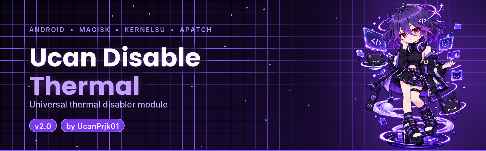

 

**[🌐 Website](https://ucanprjk01.github.io/Ucan_Disable_Thermal/)** · **[📥 Download](https://github.com/UcanPrjk01/Ucan_Disable_Thermal/releases/latest)** · **[📝 Changelog](CHANGELOG.md)** · **[🐛 Issues](https://github.com/UcanPrjk01/Ucan_Disable_Thermal/issues)**

---

<table>
<tr>
<td valign="middle">

## ✨ About

**Ucan Disable Thermal** is a systemless Android module that turns off thermal throttling services and replaces vendor thermal files, so the device is not slowed down when it gets warm.

Made by **UcanPrjk01**.

</td>
<td align="center" width="240">

</td>
</tr>
</table>

> [!WARNING]
> Disabling thermal protection can cause **overheating** and long-term **battery or hardware damage**.
> Use at your own risk, keep an eye on the temperature, and never use it while charging in a hot place.

## 🔧 What it does

- Stops thermal services at boot (`thermal-engine`, `thermal-hal`, `mi_thermald`, `thermald`, and others) and forces their `init.svc.*` state to `stopped`
- Sets thermal zones to disabled and turns off `msm_thermal` and its core control
- Overlays vendor thermal binaries, libraries and scripts with empty files (systemless, nothing on `/system` is touched)
- Replaces the vendor `thermal-*.conf` profiles
- Sets `ro.vendor.dfps.enable` and `ro.vendor.smart_dfps.enable` to `false`

Everything is systemless, so **removing the module and rebooting restores stock behaviour**.

## 📲 Install

1. Download the latest `Ucan_Disable_Thermal-vX.Y.zip` from [Releases](https://github.com/UcanPrjk01/Ucan_Disable_Thermal/releases/latest).
2. Open **Magisk**, **KernelSU** or **APatch** → **Modules** → **Install from storage**.
3. Pick the zip, wait for it to finish, then **reboot**.

Updates arrive inside the manager app through `updateJson`.

Made with 💜 by UcanPrjk01

